### hi, i'm charity

comp eng student. I mostly do ui/ux and full-stack web stuff, and sometimes hardware.

i usually start in figma, then build it in next.js. when a project needs to move or sense something, it ends up on an esp32.

 

**stuff i've built**

- [SAGIP-AI](https://github.com/helidastar/SAGIP-AI): emergency reports that get ranked by how urgent they are, so the worst ones show up first
- [GARBO](https://github.com/helidastar/GARBO): waste app for campus. segregate your trash properly, get rewarded
- [PestBlaster](https://github.com/helidastar/PestBlaster): a camera turret that spots pests in the garden and sprays them with organic deterrent
- [Hiraya](https://github.com/helidastar/Hiraya): journal + mood tracker with a small community feed
- [PalengKart](https://github.com/helidastar/PalengKart-Console): inventory and POS for small stores, runs in the console (C#)

 

**what i use**

  
  
  
  
  
  
  
  
   
  
  
  
  
  
  
  
  

 

**my github, in numbers**

  

  <picture>
    <source media="(prefers-color-scheme: dark)" srcset="https://raw.githubusercontent.com/helidastar/helidastar/output/activity-dark.svg" />
    
  </picture>

  <picture>
    <source media="(prefers-color-scheme: dark)" srcset="https://raw.githubusercontent.com/helidastar/helidastar/output/snake-dark.svg" />
    
  </picture>

 

**say hi**

&nbsp; 
